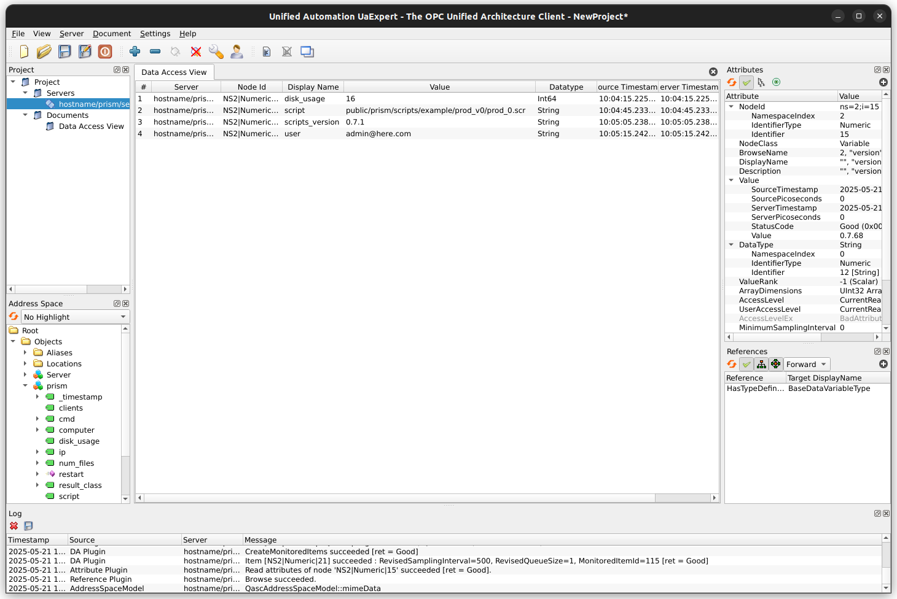

.. _mes-integration:

Manufacturing Execution System (MES) Integration
################################################

Manufacturing Execution Systems (MES) offer many benefits including enhanced visibility into
production, improved efficiency, cost reduction, and better inventory monitoring.

The Prism-Lente framework supports integration using industry standard protocol OPC-UA.
Information about the OPC-UA standard is available from the OPC Foundation:

  https://opcfoundation.org/about/opc-technologies/opc-ua/

.. contents::
   :local:

OPC-UA Integration
******************

Operation
=========

Currently the status information uploaded to the upstream Lente server are published. Values are
updated every 10 seconds.

The OPC-UA server must be enabled in the settings.json file.  See settings section for details.

For development and testing a free client is available from Unified Automation:

  https://www.unified-automation.com/products/development-tools/uaexpert.html

Endpoint and Address Space
==========================

- Endpoint: `opc.tcp://<listen_addr>:<port>/<hostname>/prism/server/` (Prism, port 4840) or
  `opc.tcp://<listen_addr>:<port>/<hostname>/lente/server/` (Lente, port 4841)
- Namespace URI: `urn:sistemi.ca/prism_lente`
- The fields below are variables of an object named `prism` or `lente`, of object type `prism_lente`.
- Values are updated every 10 seconds.

Fields Published
================

- auto_sync_scripts: The `auto_sync_scripts` setting
- cmd: Last command remotely executed
- computer: Host name of host system
- disk_usage: Percentage of file storage space consumed on drive where result files are stored
- ip: IP address of host system
- num_files: Number of result backup files are stored in result_bkup_dir
- result_class: Not used
- script: Currently loaded Prism script (if any), empty on Lente
- scripts_version: Version of the scripts directory
- user: Currently logged in user (if any)
- version: Version of the Prism/Lente base directory
- clients: Listing of downstream Prism/Lente systems and their attributes, empty on Prism
- upstream_computer: The Lente this computer reports to
- _timestamp: Time of the last successful ping to the upstream Lente

Methods
=======

- restart: Restart Prism or Lente application; causes active users to be logged out.

Settings
========

opcua_server settings are defined in the settings.json.

Example settings:

::

  "opcua_server": {
    "enable": true,
    "security_policies":[
      "NoSecurity",
      "Basic256Sha256_Sign",
      "Basic256Sha256_SignAndEncrypt"
    ],
    "certificates": {
      "enable": true,
      // "path": "public",
      // "certificate_file": "cert.pem",
      // "private_key_file": "key.pem",
    }
  }

OPC-UA Server
-------------

Section Name: opcua_server

Location: settings.json under top level

- enable: If true, start opcua_server

  - default: false

- listen_address: IP address for opcua_server to listen

  - default: 0.0.0.0

- listen_port_prism: TCP port for Prism opcua_server to listen

  - default: 4840

- listen_port_lente: TCP port for Lente opcua_server to listen

  - default: 4841

- security_policies: List OPC-UA security policies to permit clients to connect with

  - Possible values: NoSecurity, Basic256Sha256_Sign, Basic256Sha256_SignAndEncrypt
  - Default: NoSecurity, Basic256Sha256_Sign, Basic256Sha256_SignAndEncrypt

- fields: List of fields to publish (null: publish all)

  - Default: null (publish all)
  - Every name must be one of the published fields above, an unknown name stops the OPC-UA server from starting

Certificates
------------

Certificate and key files can be the same ones as used by Prism/Lente to secure access
using HTTPS. See :ref:`HTTPS and SSL Certificates<https>`.

Section Name: certificates

Location: settings.json under section 'opcua_server'

- enable: If true, use certificates

  - default: false

- path: Path to directory where certificate and private key files reside relative to the Prism or Lente root path

  - default: public

- private_key_file: File containing private key

  - default: key.pem

- certificate_file: File containing certificate

  - default: cert.pem
