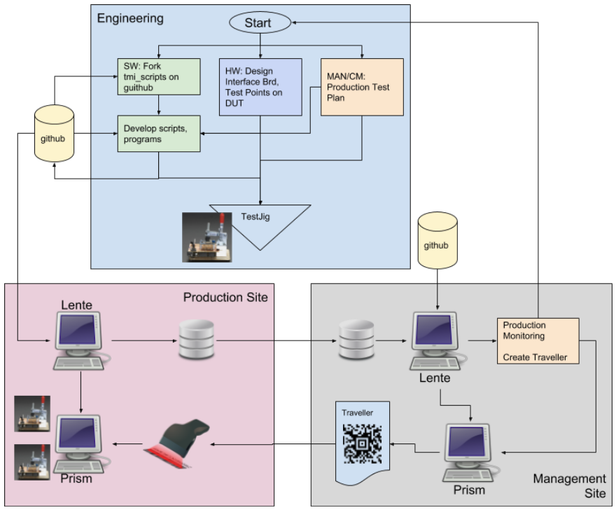
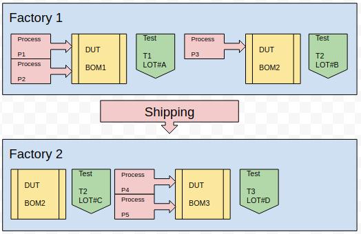
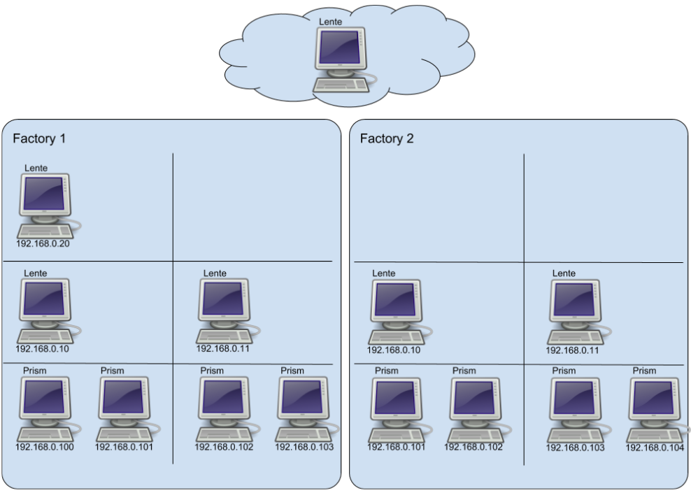

Production Planning
###################

What follows is a general discussion of a production flow, and how Lente/Prism
is configured for it.

.. contents::
   :local:

Production Infrastructure Cycle
*******************************

The above diagram presents a flow for developing and deploying scripts.

Git is used as a repository for development and releases.  Your scripts repo is a fork of the
Sistemi `scripts` repo on GitHub.

Lente script sync is used to deploy scripts to Prism stations.  Each station receives a copy of the
Lente `public/prism` folder (drivers and scripts), see :ref:`_security:Script Sync Exclusions`.
Stations get the scripts from Lente; Lente never connects to a station.  Lente can sync stations
automatically when the scripts version changes (`auto_sync_scripts` in
:ref:`settings.json <deploy-settings-file>`), and the root Lente can `git pull` new scripts from the
Station Manager page.

`settings.json` is not synced.  Each Prism and Lente computer has its own copy, set up when the
computer is installed, see :ref:`_deployment:Prism Computer Checklist`.

Stages
******

Consider the following simplified production flow diagram,

* There are two factories belonging to two different sub-contractors
* The product is represented by ``DUT``
* Factory 1 does two process steps (P1 and P2) to create the first version of the DUT,
  called BOM1 (Bill of Materials)
* The product is then tested, T1
* Then process step P3 is done, creating DUT BOM2, and the product is tested again, T2
* The DUT is shipped to the next factory, and the first thing that is done is a
  repeat of the (outgoing) test T2, this is so that any DUT material damaged in shipping is
  quantified before Factory 2 does any processing.

  * This re-testing is referred to as "incoming" inspection/test
  * This is often required so that damaged or faulty DUT can be quantified before
    more processing is done on the DUT
  * Responsibility for damaged or faulty product needs to be assigned to the right sub-contractor
  * The same T2 script runs in both factories.  The `location` of the result tells the outgoing
    and incoming tests apart

* Factory 2 does process steps P4 and P5, creating DUT BOM3, and the product is tested, T3

Each test in the diagram has its own lot (LOT#A to LOT#D).  The lot is the work order of that
stage, so the same units can have a different lot at each stage.  The results of one unit are
found together by its serial number (`key0`), not by its lot, see
:doc:`Traceability <_traceability>`.

Planning Your Test Stages
=========================

Each test stage is a separate script, usually run on its own jig.  How many stages you need depends on
your process steps, not on Prism.

Add a test stage,

* after a process step that is expensive to undo, so faults are found before more value is added.
  For example, test the PCBA before it is put in an enclosure.
* where the parts that can be tested change.  After assembly some test points can no longer be reached,
  and a Bed of Nails test must move to the connectors or to the DUT's own interfaces.
* when the product moves to another factory or sub-contractor (incoming test).

Fewer stages are cheaper to run and to maintain, as each stage needs a jig, a script, and operators.

A common plan for a PCBA in an enclosure has two stages,

* Board Level Test (BLT), on a Bed of Nails jig, before assembly

  * check the power rails
  * program the bootloader or firmware
  * connect to the DUT, record its serial number, unique id and firmware version
  * write the hardware revision to the DUT, calibrate, and check the calibration

* Final Assembly Test (FAT), after assembly, through the product's connectors

  * connect to the DUT, check its serial number and firmware version
  * functional tests that need the full assembly
  * print the product label

Programming can be its own stage when programming takes much longer than testing, so that more
programming jigs can feed one test jig.

Within a stage,

* start with a setup item and end with a teardown item, and keep the teardown enabled.  The last
  item of the script is the teardown, Prism runs it after a fail, a timeout or an abort, see
  :ref:`prism_programs:Timeouts and Aborts`.
* keep ``fail_fast`` on, unless the tests are independent of each other.
* order the tests so the cheapest and most likely failures come first.  For example check the power
  rails before programming.
* put the limits in the script, on each item, so they can be changed without changing code, see
  :ref:`prism_scripts:Script Design`.
* one test item method can be used by several items, for example a voltage check for each rail,
  with the rail name and limits in each item,

  ::

      {"id": "BLT100_voltage", "enable": true, "name": "V3V3", "min": 3200, "max": 3400 },
      {"id": "BLT100_voltage", "enable": true, "name": "V1V8", "min": 1725, "max": 1875 },

  Both items have the same item name, ``BLT100_voltage``, so the measurement name is built from
  the rail name to keep the two measurements apart.

* each program has all of its test items, there is no shared module of test items between
  stages or products.  Pure helper functions (a checksum, a DUT protocol) can be in their own
  module, see :ref:`prism_scripts:Keep the program simple`.

To decide what a Bed of Nails stage must test, and which test points the board needs, do a
:doc:`test coverage analysis <_coverage>`.

Use the same unit id, key slots and measurement names (the last part of the name, for example
``fw_ver``) in every stage, so that the results of all stages of a unit can be found together, see
:doc:`Traceability <_traceability>`.

File Organization
*****************

Naming and organizing the location of files is a difficult thing to prescribe because your needs
may require a specific solution.  Regardless, a general proposal will be given and from there one can
create a more specific solution.

The proposed general purpose solution assumes that version control is an important issue for you.

Consider the following scenario.  A product is in full production and there is a test that is having a 1% failure
rate, but none of the customer returns are associated with failures for this test.  So an ECO is created to change the
limit of the test to reduce the failure rate to an expected 0.5%.  How should you implement this change so that you
can track the new failure rate?  Or search if a product returned would have failed at the previous limit?  These
are the kinds of things you need to think about when you implement test program and script files.
The `Naming Proposal`_ below answers these questions, see `An ECO Changes A Limit`_.

Prism has a high level prescribed directory structure.

Constraints:

* all Prism files must be under ``./public/prism``
* all script files must be under ``./public/prism/scripts``
* files the tests need, such as firmware images, go in an ``assets`` folder next to the script,
  so they are versioned and synced with the script
* the scripts package sent to the stations has a maximum size (`scripts_zip_max_mb` in
  :ref:`settings.json <deploy-settings-file>`).  Leave large files that the stations don't need
  out of it with ``public/prism/scripts_zip.exclude``, see :ref:`_security:Script Sync Exclusions`

Naming Conventions
==================

A naming strategy is up to you.  Not having a strategy is also a choice.

That being said, experience has taught that not having a strategy quickly leads to confusion.
Planning up front pays off 1-2 years later, when you need to piece together when you built what,
with what version of the test, with what ECO, on what version of BOM, ...

Names that describe things are easy to start with, but they stop fitting as products and
versions are added.  Plain numbers keep working, with a list (often a spreadsheet) that says what
each number is.

The names you choose end up in the result database, and they are what you search on,

* the script file name, recorded with each result (`meta_script`)
* the program (module) and test item names, which are the start of each measurement name
* the measurement names
* the ``info`` fields of the script: `product`, `bom`, `lot` and `location`
* the keys, such as the serial number, see :ref:`_traceability:Key Slot Plan`

This is a lot to wrap your head around, so to avoid future confusion, a proposal for structure is presented.

Naming Proposal
***************

The proposal in short,

* the version of a test is in the **script** file name only
* program files, test item methods and measurement names are not versioned.  A name stays the same
  as long as what it measures stays the same

This keeps the measurement names the same across versions, so trend charts and queries cover the
whole life of a product, and the script name separates the versions.

Names In The Database
=====================

Each measurement is stored with its full name, the program module path, the item ``id`` and the
measurement name,

::

    mycompany.P001.P001_BLT.BLT100_voltage.V3V3
    \_______/ \__/ \______/ \____________/ \__/
     folder   folder program  test item    measurement

The script file name is not part of it.  The script is recorded with each result, in
`meta_script`.  So,

* renaming the program file, its folder, or a test item method gives each of its measurements a
  new name, and starts a new series in the database
* a new version of a script changes only `meta_script`

The full name is at most 128 characters.  Prism ends the item as ``INTERNAL_ERROR`` when it is
longer, so keep the parts short.

Product
=======

* ``P###``

  * ### => 001, 002, etc, a product number

* In a spreadsheet (or other tool) keep a list of P### that correspond to internal project names,
  or actual BOM numbers, etc.
* the ``info`` `product` of the script is the product number, for example ``P001``.  The Lente
  Throughput & Yield chart counts the units of each `product`
* a model or variant that is tested the same way is the same product.  Put its BOM in the ``info``
  `bom`.  A model that is tested differently is a new product number

Folders and Files
=================

::

    public/prism/scripts/mycompany/P001/P001_BLT.py
    public/prism/scripts/mycompany/P001/P001_BLT_00.scr

* ``mycompany`` - one folder for all your products
* ``P001`` - one folder for each product
* ``P001_BLT.py`` - the program of a stage, ``<product>_<stage>.py``, not versioned
* ``P001_BLT_00.scr`` - the script of a stage, ``<product>_<stage>_<vv>.scr``

  * stage => BLT, FAT, PROG, ..., a short name of the test stage, see
    `Planning Your Test Stages`_
  * vv => 00, 01, etc, the script version

* the program file name and the class name must match, see :ref:`prism_programs:Program Class Structure`
* folder, program and item names are Python names: letters, digits and ``_`` only, starting with
  a letter.  No ``-``, spaces or dots
* a stage can have more than one script, for example a script for each product variant, or for
  rework, ``P001_BLT_REWORK_00.scr``.  They can share the stage program

Test Items
==========

* ``<STAGE>nnn_<description>``, for example ``BLT100_voltage``

  * STAGE => the stage name, so the item names of each stage are different
  * nnn => 000 to 999, the test number.  Number in steps of 10 or 100, so a new test can go
    between two others
  * description => a few words, lower case
  * ``<STAGE>000_SETUP`` is the first item, ``<STAGE>990_TEARDOWN`` the last

* test items are not versioned, see `When The Code Changes`_

Measurements
============

* a short lower case name, or the name of the rail or signal it measures, for example ``fw_ver``,
  ``V3V3``
* the same name in every stage for the same value, for example ``fw_ver``
* the name of a repeated item comes from the item, ``"name": "V3V3"`` above

Fail Messages
=============

* ``fid`` => the test number and a count, for example ``BLT100-1``, ``BLT100-2``
* ``msg`` => at most 64 characters, see :ref:`prism_scripts:Script Design`

Info Fields
===========

The ``info`` fields of the script are database columns, see :ref:`prism_scripts:info`,

* `product` - the product number, ``P001``
* `bom` - your BOM number and revision, ``B00012-001``
* `lot` - the work order, usually from a ``subs`` entry with a ``regex``, see
  :ref:`_traceability:Lots`
* `location` - the factory, or line, ``FACTORY1``

Script Versions
===============

Make a new version of a script, ``P001_BLT_01.scr``, when the test changes in a way you want to
see in the results, for example an ECO that changes a limit.

* copy the script to the next version number, and change the copy
* say why at the top of the new script, ``// ECO-123: V3V3 max 3400 -> 3450``, and in the git
  commit
* the program is not copied.  All versions of the script use the same program
* remove the old version once the new one is in production, git keeps it.  Every result records
  the scripts version (`meta_git_public`), so the exact old files can always be found

Changing a script in place, keeping its name, also works.  Its results are then separated by
`meta_git_public` or by date, not by `meta_script`.

When The Code Changes
=====================

.. list-table::
   :header-rows: 1
   :widths: 40 35 25

   * - Change
     - What to do
     - Measurement names
   * - a limit, enable, add or remove an item, in the script
     - new script version
     - unchanged
   * - a fix in the test code, the measurement still means the same
     - change the program in place, and a new script version if you want it separate in searches
     - unchanged
   * - the measurement now means something else, a new test point, method or unit
     - a new test item method, ``BLT101_voltage``, used by a new script version
     - new, on purpose
   * - a new test
     - a new test item method, ``BLT200_current``
     - new

Because all versions of a script use the same program, an old script breaks if the program no longer
has a method it uses.  Remove old scripts from the folder, and check the scripts with
``prism_dev.py --lint`` before a release.

An ECO Changes A Limit
======================

The scenario from `File Organization`_: the ``V3V3`` test fails 1%, and an ECO widens the limit.

#. Copy ``P001_BLT_00.scr`` to ``P001_BLT_01.scr``, and change ``"max": 3400`` to ``"max": 3450``.
   The program does not change.
#. Release the scripts, and stations get them from Lente.

Both versions record ``mycompany.P001.P001_BLT.BLT100_voltage.V3V3``.  So,

* the trend chart of ``V3V3`` covers before and after the ECO
* the failure rate of each version,

  ::

      select r.meta_script, r.meta_result, count(*)
      from record r
      where r.info_product = 'P001'
      group by r.meta_script, r.meta_result

* would a returned unit have failed the old limit?  Each measurement has its value and the limits it
  was checked against,

  ::

      select r.key0, m.value, m.min, m.max, r.meta_script
      from measurement m join record r on m.record_id = r.id
      where m.name = 'mycompany.P001.P001_BLT.BLT100_voltage.V3V3'
            and r.key0 = 'sn:A12345'

Naming Example
==============

Files,

::

    ./public/prism/scripts/mycompany
    ./public/prism/scripts/mycompany/P001
    ./public/prism/scripts/mycompany/P001/P001_BLT.py
    ./public/prism/scripts/mycompany/P001/P001_BLT_01.scr
    ./public/prism/scripts/mycompany/P001/P001_FAT.py
    ./public/prism/scripts/mycompany/P001/P001_FAT_00.scr
    ./public/prism/scripts/mycompany/P001/assets/P001_fw_1.2.hex

Script ``P001_BLT_01.scr``,

::

    // P001 Board Level Test (BLT)
    // ECO-123: V3V3 max 3400 -> 3450
    {
      "subs": {
        "Lot": {
          "title": "Lot (format L####)",
          "type": "str", "widget": "textinput", "regex": "^L\\d{4}$", "default": "L0001"
        }
      },
      "info": {
        "product": "P001",
        "bom": "B00012-001",
        "lot": "%%Lot",
        "location": "FACTORY1"
      },
      "config": {
        "fail_fast": true,
        "drivers": ["public.prism.drivers.fake.hwdrv_fake"]
      },
      "tests": [
        {
          "module": "public.prism.scripts.mycompany.P001.P001_BLT",
          "options": {},
          "items": [
            {"id": "BLT000_SETUP",    "enable": true },
            {"id": "BLT100_voltage",  "enable": true, "name": "V3V3", "min": 3200, "max": 3450,
                                      "fail": [{"fid": "BLT100-1", "msg": "V3V3 out of range: check U1"}]},
            {"id": "BLT100_voltage",  "enable": true, "name": "V1V8", "min": 1725, "max": 1875,
                                      "fail": [{"fid": "BLT100-2", "msg": "V1V8 out of range: check U2"}]},
            {"id": "BLT200_program",  "enable": true, "file": "P001_fw_1.2.hex", "timeout": 30 },
            {"id": "BLT300_fw_check", "enable": true, "version": "1.2" },
            {"id": "BLT990_TEARDOWN", "enable": true }
          ]
        }
      ]
    }

Program ``P001_BLT.py``,

::

    #! /usr/bin/env python
    # -*- coding: utf-8 -*-

    import logging
    from core.test_item import TestItem
    from public.prism.api import ResultAPI

    # file name and class name must match
    class P001_BLT(TestItem):

        def __init__(self, controller, chan, shared_state):
            super().__init__(controller, chan, shared_state)
            self.logger = logging.getLogger("SC.{}.{}".format(__name__, self.chan))

        def BLT000_SETUP(self):
            ctx = self.item_start()  # always first line of test
            ...
            self.item_end()  # always last line of test

        def BLT100_voltage(self):
            ctx = self.item_start()  # always first line of test
            value = ...  # measure the rail ctx.item.name
            _, result, bullet = ctx.record.measurement(ctx.item.name, value, ResultAPI.UNIT_MILLIVOLTS,
                                                       min=ctx.item.min, max=ctx.item.max,
                                                       fail=ctx.item.fail[0])
            self.log_bullet(bullet)
            self.item_end(result)  # always last line of test

        def BLT200_program(self):
            ...

        def BLT300_fw_check(self):
            ...

        def BLT990_TEARDOWN(self):
            ctx = self.item_start()  # always first line of test
            ...
            self.item_end()  # always last line of test

See :ref:`prism_scripts:Script Design` for a complete ``BLT100_voltage``.

IP Addressing
*************

What follows is a simple design for allocating the IP addresses of Prism and Lente
computers.  You may decide to do this differently.

Connections only go up the hierarchy.  A Prism connects to its Lente, and a Lente connects to
the Lente above it (`result_server_url` in :ref:`settings.json <deploy-settings-file>`).  Nothing
connects down to a Prism or to a lower Lente.

Assumptions:

* the LAN is 192.168.0.X
* the fixed addresses below are outside the range your router (DHCP server) gives out.  Many
  routers give out addresses in 192.168.0.X, check its DHCP range

Lente IPs
=========

Each Lente needs a fixed IP address, because the computers below it connect to it.

* Label each PC with its IP address
* The tens digit is the level of the Lente in the hierarchy, the ones digit counts the Lentes of that
  level

  * 192.168.0.10 (first Lente at the lowest level)
  * 192.168.0.11 (second Lente at the lowest level)
  * 192.168.0.20 (first Lente at the next level up)
  * etc

Prism IPs
=========

Prism only needs the address of its Lente (the ``--server`` of ``prism.sh``).  A fixed IP address
is not required, but it is easier to support a station when you know its address.

* Label each PC with its IP address
* Addresses

  * 192.168.0.100  (first Prism)
  * 192.168.0.101
  * 192.168.0.102
  * etc

Lente In The Cloud
==================

A Lente at the top of the hierarchy can be in the cloud.

* its address is set in `result_server_url` of each Lente below it, with the port, for example
  ``"https://lente.mycompany.com:6595"``
* use HTTPS, with a certificate signed by a public certificate authority, see
  :ref:`_security:HTTPS and SSL Certificates`
* the factory makes outbound connections only, no port has to be opened into the factory network

Example
=======

In this example there are two factories,

* no computers are exchanged between the factories
* Factory 1 has two levels of Lente, 192.168.0.10 and 192.168.0.11 send results to 192.168.0.20
* Factory 2 has one level of Lente, both send results to the Lente in the cloud
* The address of the Lente in the cloud is given to you by whoever runs it

