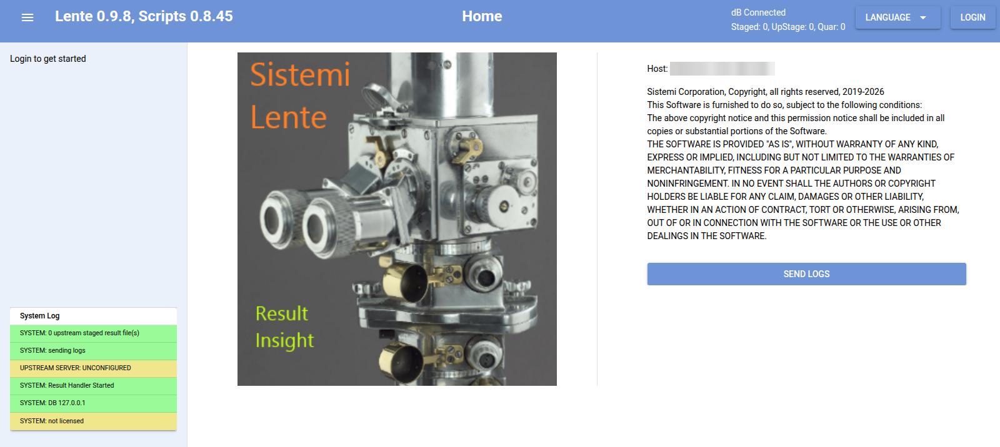

Lente
=====

Lente is a backend server that has two main functions.

* dB (Postgres) interface

  * receives results from connected Prism computers
  * stores test results into the dB
  * provides dashboarding to monitor test results in realtime (`Result Search`, `Result Analytics`)
  * can forward results to an upstream Lente

* Management console for Prism Computers (`Station Manager`)

  * realtime view, showing health and status
  * Create Users with Roles and deploy them to Prism Computers
  * deploy test scripts, manually or automatically

* `Create Traveller`, the same as on Prism

.. toctree::
   :maxdepth: 2
   :caption: Contents:

   lente_demo
   lente_screenshots
   lente_accounts
   lente_cloud
